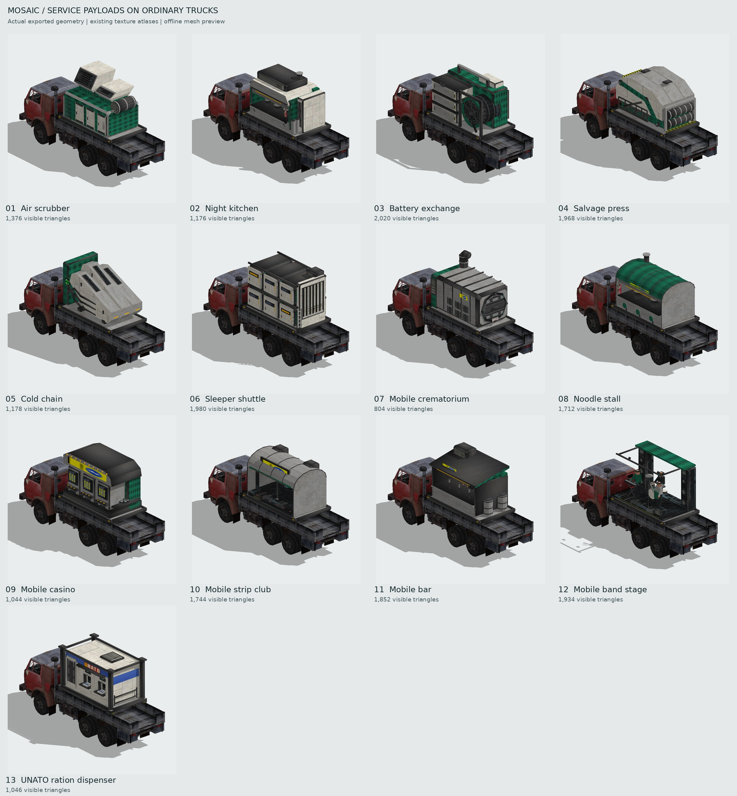
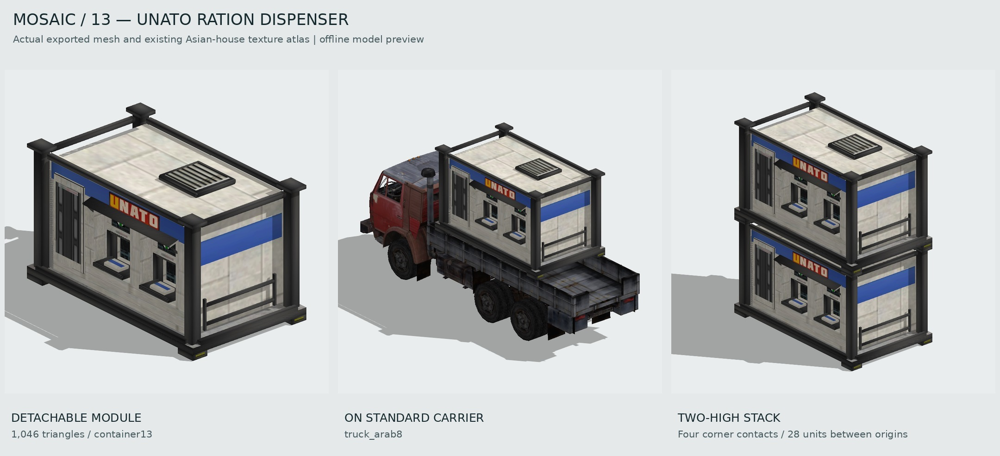

# Civilian service truck payloads

Ordinary traffic can carry one new modular service payload, `truckpayloadservice`,
using `objects3d/truckPayloadService.dae`. The model contains an empty `center`
root and thirteen complete child pieces named `container1` through `container13`.
The unitscript uses the existing numbered piece-group helper, hides the model's
pieces, and shows exactly one body.

## Bodies

| Piece | Body | Visible triangles | Existing behavior reused |
| --- | --- | ---: | --- |
| container1 | Municipal air scrubber | 1,376 | Ordinary civilian traffic |
| container2 | Night kitchen | 1,176 | Ordinary civilian traffic |
| container3 | Battery exchange | 2,020 | Ordinary civilian traffic |
| container4 | Salvage press | 1,968 | Ordinary civilian traffic |
| container5 | Cold chain | 1,178 | Ordinary civilian traffic |
| container6 | Sleeper shuttle | 1,980 | Bus passenger arrival and departure |
| container7 | Mobile crematorium | 804 | Ordinary civilian traffic |
| container8 | Noodle shop | 1,712 | Ordinary civilian traffic |
| container9 | Rolling casino | 1,044 | Ordinary civilian traffic |
| container10 | Mobile strip club | 1,744 | Ordinary civilian traffic |
| container11 | Travelling bar | 1,852 | Ordinary civilian traffic |
| container12 | Band stage | 1,934 | Ordinary civilian traffic |
| container13 | UNATO ration dispenser | 1,046 | Ordinary civilian traffic |



This preview renders the exported COLLADA pieces and existing truck geometry
with their actual diffuse atlases. It is an offline mesh preview, not a Recoil
screenshot. The bundle stores 19,834 triangles in total; a truck displays only
its selected 804–2,020-triangle piece. Fine grilles, shutters, panel wear, labels
and latches use the existing atlas. Geometry is reserved for the broad body
shapes and recognizable equipment. The venue staff and band musicians are small,
clothed static figures baked into their complete payload pieces. These bodies do
not add separate actors, a music system or deployment animations.

Each body has a payload tooltip that is also appended to its carrier's tooltip
after the carrier has initialized its registration plate. The sleeper body joins
`GG.BusesTable`, just like the original bus bodies. The existing civilian daily
life system resolves that attached payload to its carrier for passenger events.
The other bodies retain the ordinary civilian traffic routines.

## Stackable UNATO ration module

`container13` is a compact ration dispenser with two recessed meal bays,
collection trays, card/token faces, a shallow canopy and a folded queue rail.
It reuses the existing Asian-house material set. Its UNATO placard samples
individual letters from an existing atlas poster on five flat quads; the
texture images themselves remain unchanged. The grilles, door hardware,
instructions and surface wear also come from that atlas.



Four structural corner feet align with flat roof pads, while the roof equipment
and canopy sit below the stacking plane. The cradle between the feet is raised,
so the upper module bears on the corners rather than on the ventilation unit.

| Stacking property | Engine units, in authored payload coordinates |
| --- | --- |
| Identical-copy origin offset | `(0, 28, 0)` |
| Lower contact plane | `Y = 2.1` |
| Upper contact plane | `Y = 30.1` |
| Four contact centres | `X = ±12.2`, `Z = ±21.8` |
| Each contact footprint | `3.6 × 4.4` in X/Z |

Keep X, Z and heading aligned and translate each successive copy by 28 units
in Y. The exported manifest stores this contract in the ration variant's
`stack` object. The native mesh test measures the contact surfaces and corner
load paths, and verifies that a translated copy clears all lower-module
geometry. The preview uses those same exported vertices and placement offset.

Traffic uses one selected module per carrier. Stacking is a model placement
contract for duplicate ration modules; the vending bays remain static world
geometry under the existing civilian payload behavior.

## Spawn distribution and scope

Every fourth successfully created and attached eligible ordinary payload uses
the new unit. The other three use the original `truckpayload`, including its
entire original inventory, random descriptions and special behavior. None of the
original payload script or model pieces are replaced or removed.

Eligibility requires all of the following:

- The requested load is exactly `truckpayload`.
- The carrier belongs to Gaia and appears in both the current culture's civilian
  truck set and its existing loadable-truck set.
- The carrier is an ordinary numbered civilian truck family, excluding
  `truck_western3` and any carrier using `LongTruckscript.lua`.

The existing loadable set currently selects `truck_arab6`, `truck_arab7` and
`truck_arab8` in cultures that include those vehicles. This change does not make
additional carrier types loadable. Refugee loads, Fort Nox loads requested by
name, other special payloads, police and military loadouts bypass this selection.
The separate refugee loading path is unchanged.

The quota counts eligible payload spawns, not all trucks or the current live
population. The new body choices cycle through the thirteen numbered pieces in
order, giving each one appearance per thirteen new payloads. Neither decision
uses the shared random-number stream. Counters are held in
`GG.CivilianServicePayloadSelection` and `GG.CivilianServicePayloadVariants` and
are retained across gadget reconstruction when those tables remain present.

A missing new UnitDef keeps the original payload. If creating the new unit fails,
the loader tries the original payload immediately. A failed creation of both
units consumes no quota slot. Successful fallback loads count as original loads,
so exceptional creation failures can lower the new models' share below 25%.

## Model and material contract

All geometry belonging to a variant must be in its single `containerN` piece.
Independent child pieces would remain visible when only their parent's piece is
hidden, so the thirteen bodies must stay flat beneath `center`.

The model uses the existing Asian-house texture set:

- `unittextures/house_asian_diffuse.dds` for diffuse color.
- `unittextures/house_asian_selfilu_reflection.png` for self-illumination/reflection.
- `unittextures/house_asian_normal.dds` for the UnitDef's normal map.

The shared mounting envelope has X limits ±14.2, Z limits ±24.1 and a floor at
Y 2.1 in the payload's authored coordinates. On first detecting a carrier, the
script instantly moves the empty root once using these measured offsets:

| Carrier | Y offset | Z offset |
| --- | ---: | ---: |
| truck_arab6 | 0 | -3.5 |
| truck_arab7 | 3.5 | 1 |
| truck_arab8 | 4.1 | 0 |

Attachment is polled every 100 ms before a carrier is found, then every 500 ms.
Changing or losing the carrier resets the previous fit and applies the new fit.
The tooltip delay does not delay model fitting. Original payload fitting is
unchanged. The new unit inherits the original payload's transport, health,
footprint, blocking and movement properties through its UnitDef. It remains
neutral, unselectable and nonblocking when detached.
The TeamPlatter widget recognizes `customparams.civilian_service_payload` and
omits a second platter on the attached body while preserving the carrier's
platter.

## Verification

Run from the repository root:

```sh
python3 tools/truck_service_payloads/generate.py
texlua tests/truck_service_payloads_test.lua
texlua tests/truck_payload_attachment_test.lua
texlua tests/civilian_spawn_type_guard_test.lua
python3 tests/truck_service_payload_models_test.py
```

The generator uses only the Python standard library and deterministically
rebuilds the single model, sidecar and manifest. The native model check requires
NumPy, `assimp_py` and `texlua`; it independently verifies the thirteen-piece
hierarchy, winding, normals, texture islands and actual carrier mesh clearance.
It caps each visible body at 3,000 triangles and the complete bundle at 30,000.

To rebuild the actual-mesh preview, install Pillow, NumPy, `assimp_py`,
`moderngl` and `glcontext`, then run:

```sh
python3 tools/truck_service_payloads/render.py --update-repo-preview
```

The same command updates the UNATO three-view sheet, including the two-high
stack. Use `--piece 13` to inspect only that module while authoring.

The renderer uses headless EGL. `--carrier truck_arab6` and
`--carrier truck_arab7` inspect the other two compatible carriers; the default
is `truck_arab8`. Rendering and geometry checks have been performed for all three.

The focused test executes the production selector, loader callback, UnitDef and
whole unitscript, including the original piece-group helper. It checks exact
25/75 distribution, all thirteen variant choices, excluded carriers and payloads,
missing definitions, creation fallback, single-piece visibility, transport
properties, sleeper bus registration, carrier fitting, delayed tooltips,
detachment, reattachment, stale transporter IDs during destruction, and the
TeamPlatter filter using the production widget.
The full quota fixture runs 104 eligible loads: 78 original payloads and 26
service payloads, with two appearances for every service variant.

Engine acceptance should include all thirteen bodies on each of the three ordinary
carriers, night/day materials, camera distance, carrier destruction and refugee
conversion. Lua fixtures verify state and API behavior; they do not establish
live Recoil appearance or performance.
