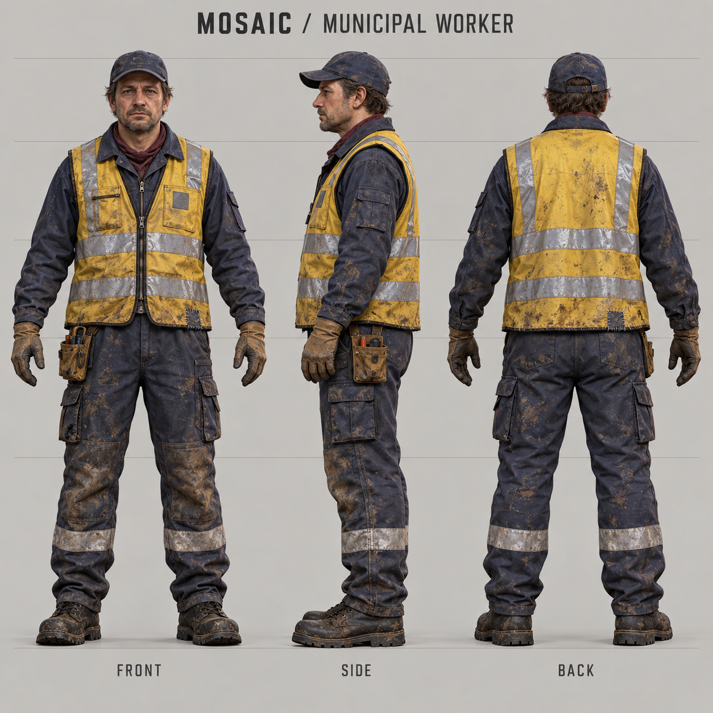
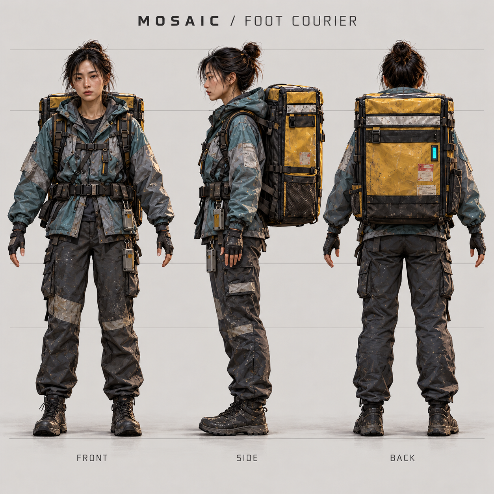
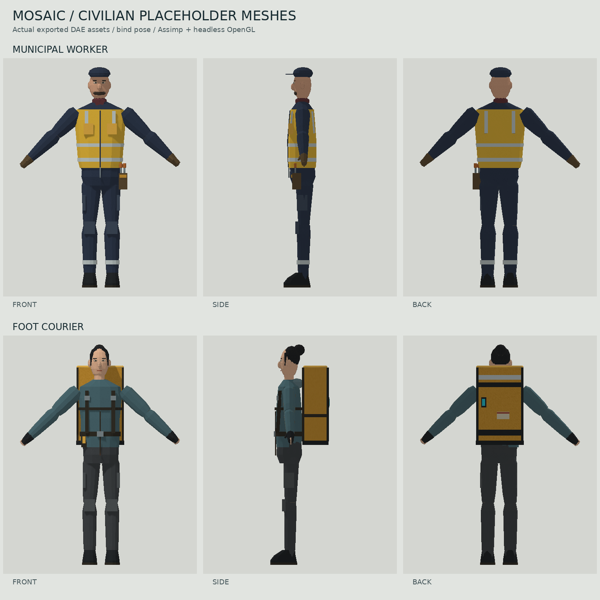

# Worker and courier civilians

Two occupational civilians extend the ordinary street population. Their large
clothing and equipment shapes follow the character turnaround concepts: a
Western maintenance worker in dark overalls and a yellow reflective vest, and an
Asian woman courier in a slate jacket with a large ochre delivery pack.

| Unit name | Population cultures | Disguise selection | Model |
| --- | --- | --- | --- |
| `civilian_worker_western` | Western, international | Male in the same cultures | `civilian_worker_western.dae` |
| `civilian_courier_asian` | Asian, international | Female in the same cultures | `civilian_courier_asian.dae` |

The models are functional placeholders. The cap, vest, hair and pack are part of
the visible anatomical meshes, so body rebuilds cannot discard the occupational
silhouette when shopping, talking, protesting or changing state. The model
hierarchy retains the existing civilian animation and prop contract.

## Asset budget

| Model | Ordinary visible body | Complete exported model | Piece count |
| --- | ---: | ---: | ---: |
| Worker | 3,633 triangles | 6,261 triangles | 98 |
| Courier | 3,636 triangles | 6,264 triangles | 98 |

The complete counts include normally hidden props and protest letters. The
reference civilian model contains 36,144 triangles. These counts describe asset
complexity; they are not a measured frame-rate improvement. Both occupations
share one set of 1024 by 1024 diffuse, special and normal maps.

## Art references

The square turnaround sheets establish the visual target. They are concept art;
the game assets are deliberately simpler, articulated placeholder meshes.





## Population and behavior

Both definitions inherit `Civilian` and use the unchanged `civilianscript.lua`.
Movement, hit points, collision, category, idle and walk animations, shopping
bags, phone use, prayer, protest, panic and existing arming behavior stay within
the established civilian systems. The worker's tool pouch and the courier's pack
are visual identity; this addition does not introduce a separate job simulator.

The existing culture translation expands its numbered family and then its
explicit `additionalNames`. The worker supplements the Western family. The
courier supplements the Asian culture's existing Arab-model fallback. Every old
family member and existing behavior remains available. International cities
include both additions. Population limits and update schedules are unchanged.

All users of the shared culture helpers see the same membership: pedestrian
spawning, mobile classification, daily-life registration, panic, interrogation
and aerosol handling. The matching disguise pools include the same new models;
an occupational outfit is also worn by innocent ambient civilians. Explicit sex
entries in `lib_staticstring.lua` prevent name selection from falling back to
unit-ID parity for these models.

The new UnitDefs expose `civilian_role`, `civilian_culture` and `civilian_gender`
metadata for inspection. Their `baseclass` remains `Civilian`, preserving
existing mobile shadow and selection classification. Both use the shared
`civ_occupations_normal.png` normal map and their own unit pictures.

## Manual review

Start a new game with the updated archive so the engine loads the new UnitDefs,
models and textures. In a development game, spawn both at a clear location:

```text
/cheat
/give civilian_worker_western
/give civilian_courier_asian
```

1. Inspect the silhouettes at ordinary gameplay zoom and at close range. Check
   feet on the ground, facing direction, torso/limb attachment, visible vest and
   delivery pack, material appearance and selection collision.
2. Order the units to walk, stop and turn. Check feet, knees, shoulder motion,
   head motion and the rigid torso attachment of the delivery pack.
3. In Western, Asian and international populated games, confirm the expected
   new appearances join the ordinary street population and receive routes.
   Existing civilians must still spawn; Arabic population remains unchanged.
4. Observe phone use, carrying, conversations and prayer. Trigger danger and
   the existing global protest/arming states. Check that props remain attached
   and the occupational clothing stays visible through state changes.
5. Exercise the male/female operative disguise choices in the applicable
   cultures and use Guard or Blend in to accompany pedestrians. Check that
   the visible disguise follows the same animation and carrying behavior.
6. Review `infolog.txt` for missing models, textures or script pieces. Compare
   a replay or a second client before treating in-engine behavior as validated.

## Regression checks

Run from the repository root with Lua 5.1+ or `texlua`:

```sh
texlua tests/civilian_street_roles_test.lua
texlua tests/culture_unit_type_membership.lua
texlua tests/civilian_spawn_type_guard_test.lua
```

The first loads the actual UnitDef inheritance and base classes and compares
the new definitions with an ordinary civilian. The second checks all culture
membership paths, old families, occupational disguises and naming. The third
executes the real civilian gadget spawn path with engine fixtures, verifies
home/route/daily-life registration and rejects static structures from mobile
spawns. These checks do not claim Recoil rendering or multiplayer validation.

## Asset tools

The assets can be regenerated with `tools/civilian_occupations/generate.py`.
The source keeps the existing civilian piece hierarchy and authored pivot
matrices, because the shared animation data depends on those offsets.

The optional mesh validator requires Python 3, `assimp-py`, NumPy, Pillow and
`lupa` with Lua 5.1 support. The preview renderer additionally uses `moderngl`
and `glcontext` with EGL. These are authoring tools, not game dependencies.

```sh
python3 tests/civilian_street_models_test.py
python3 tools/civilian_occupations/render.py --output /tmp/mosaic-civilian-previews --update-repo-previews
```

The renderer imports the shipped DAE files through Assimp, draws the ordinary
visible body pieces and produces the two build pictures. The contact sheet is
an inspection of the exported meshes in their bind pose, not an engine capture.



## Validation performed

The independent Assimp test passed for both shipped meshes, including retained
piece names and bind transforms, geometry, UVs, normals, tangents, texture
references, alpha channels and body scale. Regeneration produced identical
bytes for all eight generated model, metadata and texture files. The exported
mesh previews were inspected and the attached garment details and boot soles
corrected before the final renders.

Ten relevant Lua regression suites passed: occupational UnitDefs, culture
membership, civilian spawn guards, invalid daily-life targets, reconstruction
blocking, prayer animations, dialogue, context-free TRIZ, conspiracy dialogue
and the conversation reader. The spawn test exercises 67 culture/mobile
combinations.

The unchanged `civilian_world_observation_test.lua` has a separate fixture gap:
it does not provide `Spring.GetSelectedUnits` or `GetSelectedUnitsCount`, called
by the existing tracking widget. Both files match the starting master commit
`35bfb6fc2bbb1df2dd4dfad5654dc4ba75c52d6a`; this addition does not change them.
Actual Recoil rendering, multiplayer behavior and target-hardware frame times
remain to be checked using the manual review steps above.
