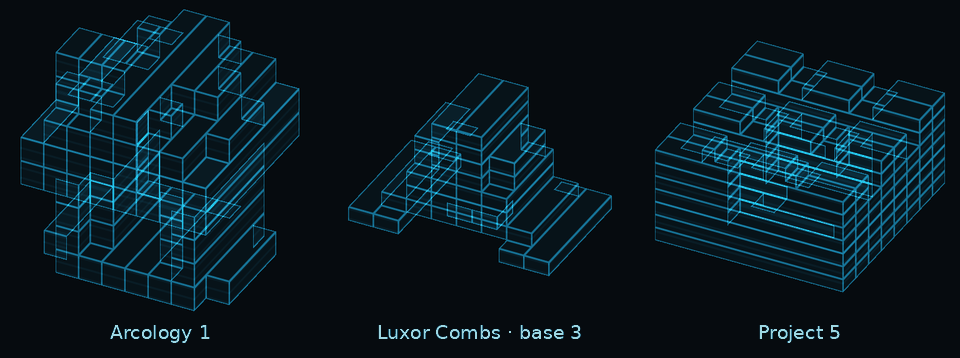

# House icon holograms

**Options → Graphics → House holograms** switches the local strategic view
between voxel silhouettes and regular house icons. The setting defaults to on
and persists across matches. Zooming inside the icon threshold shows the
ordinary building model. The residential icon distance multiplier is 0.5,
about 2,740 elmos at UnitIconDist 200 in Recoil's distance-based mode.

Selecting a safehouse or its installed upgrade colours the host amber on the
owning team's selecting player's screen. The synced attachment, replacement
and morph paths maintain the host ID in private player rules parameters.
The draw pass checks local selection and current team and excludes spectators.
Cyan geometry follows the building's normal line-of-sight and cloak checks.
Recoil builds without private player rules parameters use cyan silhouettes.

Procedural Arab, Asian and Western houses reuse the assembled building's
shadow columns, including floor masks, terrain offsets, courtyards and updates
from structural damage. The renderer meshes the exterior of the occupied runs.
Arcologies, projects, camps and Luxor Combs use an 8×8×8 mask per selected main
mesh, its imported bounds and its unit-piece transform. The silhouettes omit
small decorations and animation. The preview shows three individually framed
main meshes rendered offscreen with the production shader.

The draw pass caches one display list per house and builds up to three changed
lists per frame. Ordinary icons cover houses awaiting geometry. To rebake the
standalone profiles after editing a model, run
`python tools/house_icons/bake.py` at the game root with NumPy and SciPy.
