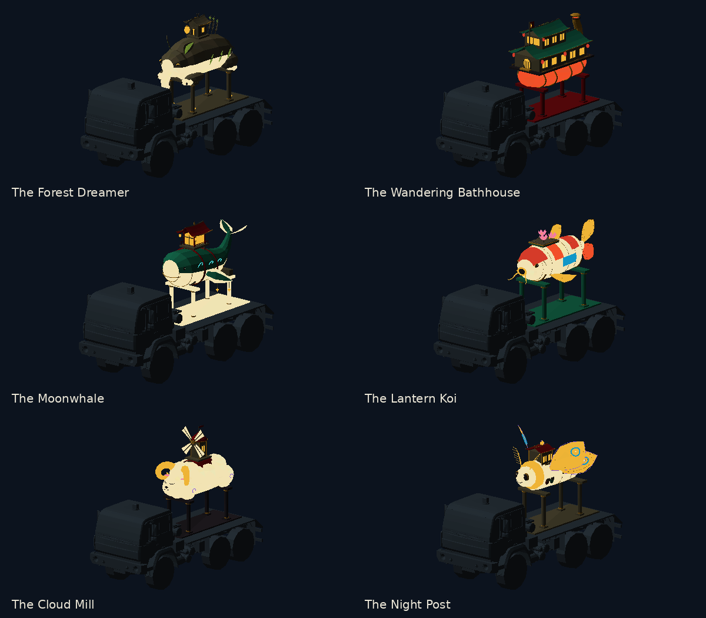
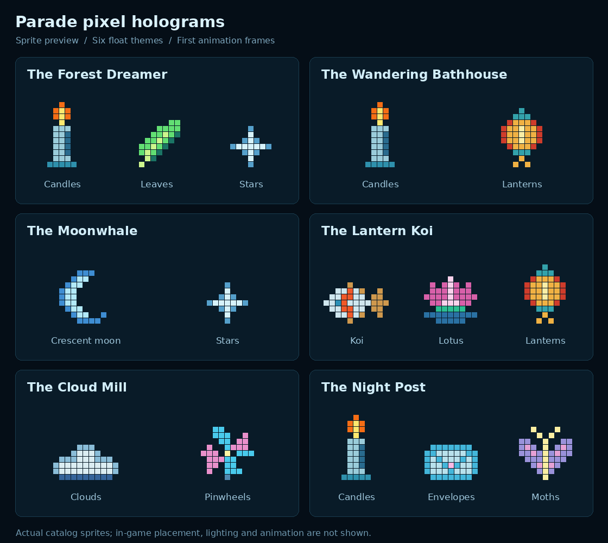

# Seventh evening city parade

A procession of illuminated float trucks visits the city on the evenings of game days **7, 14, 21, and so on**. Assembly runs from **19:00 to 20:00**, and a successful procession tours from **20:00 until 03:00 the following morning**. These are the game's simulated clock and calendar, with the same noon offset used by the existing day/night system.

The parade uses the existing civilian traffic graph, curb positions, vehicle spawning, payload attachment, civilian activity system, prayer animations, danger map, and music player. Its scheduler and limits are in [city_parade.lua](../luarules/configs/city_parade.lua); the [director](../luarules/gadgets/include/city_parade.lua) coordinates those systems.

## What happens

The city must be in its normal state before the parade can assemble. It aims to assemble **four float trucks**, requires **at least two** to tour, and moves them at **22% of their ordinary maximum speed**. Trucks leave the staging curb one at a time and maintain spacing as they follow ordinary engine movement orders.

The route builder searches the existing civilian route graph for a circuit through **four to six live, peaceful building nodes**. A smaller city can use a checked two-node out-and-back circuit. Each leg, including the return to staging, is checked through native path requests. The builder waits for asynchronous path results and checks the returned route for traversability and danger. Search, path-request, and polling budgets keep this work bounded. See [lib_city_parade_route.lua](../scripts/lib_city_parade_route.lua).

Nearby eligible civilians move to the roadside, pause, and perform existing religious upper-body gestures. A deterministic **25% selection** follows behind the procession; the resulting number depends on which civilians are eligible and nearby. At most **32 civilians** participate at once. Spectators participate for up to **35 seconds**, followers for up to **90 seconds**, and each has a **60-second cooldown** before joining again. Their ordinary travel activity is suspended and resumes when they leave. Protected or disguised civilians, passengers, wounded civilians, and civilians already occupied by incompatible activities are excluded.

Nearby intact buildings shower the procession with **confetti, origami cranes, flower petals, and inflation banknotes**. Ruins, scrap heaps, and construction sites are excluded. Emission positions follow the building's size and face the nearby float. The effects use ordinary CEG particles and respect ground line of sight.

The existing music player switches to **Seventh Night Procession**, an original **80-second, 96 BPM, 32-bar instrumental** with low drums, woodblocks, pentatonic bells and reed, and warm organ/synth. It uses the normal music channel and respects its volume, mute, included-track setting, pause-with-game option, explicit stop, and custom-track ownership. Normal music resumes when touring ends. The track is synthesized without sampled recordings.

A city emergency, an attack on a parade participant or float, or an unusable route ends the procession. Civilians release their parade activity without overwriting a newer emergency activity. Surviving trucks resume ordinary traffic and retire peacefully at a destination. Recovery uses the parade unit rules to release stale participation and resume retiring traffic after a gadget reload.

## Float models



This image previews the **imported exported meshes** on an existing carrier. It is **not a Recoil gameplay screenshot**; live lighting, traffic, crowd spacing, and particle appearance still need an in-engine playtest.

All six designs come from the existing **MOSAIC Lantern Float Cages** authoring package. Their evaluated meshes share one native payload model, [truckPayloadParade.dae](../objects3d/truckPayloadParade.dae), with one visible design per truck. The model contains the floats and their supports; carrier geometry remains in the existing truck models.

| Design | Native root piece | Articulated parts | Visible triangles |
| --- | --- | --- | ---: |
| The Forest Dreamer | `container66` | Static float | 7,902 |
| The Wandering Bathhouse | `container67` | Static float | 7,826 |
| The Moonwhale | `container68` | Separate left fin, right fin, and tail | 7,892 |
| The Lantern Koi | `container69` | Static float | 12,612 |
| The Cloud Mill | `container70` | Separate horizontal windmill rotor | 5,616 |
| The Night Post | `container71` | Four separately controlled wing pieces | 11,766 |

The bundle contains **53,614 triangles across all six variants**. Only the selected variant and its articulated pieces are shown. The Moonwhale's fins and tail and the Night Post's wings retain their authored pivots. The Cloud Mill uses a three-second pause and five-second spin cycle around its horizontal rotor axis. Unselected pieces and their motions are reset explicitly.

The [runtime catalog](../scripts/lib_truck_parade_payloads.lua) specifies selection, articulation, and carrier offsets. The [export manifest](../tools/truck_parade_payloads/manifest.json) records the meshes, triangle counts, bounds, and source information. Float UVs reuse the existing `house_asian_diffuse.dds` and `house_asian_selfilu_reflection.png` atlas islands, including the luminous colours.

### Mounting

Offsets are relative to each existing truck's `attachPoint`, in native game coordinates. The skid is **17.6 units wide and 45.6 units long**, with its authored floor **2.1 units above the payload origin**. The narrower skid fits inside the raised walls of `truck_arab8`.

| Carrier | Vertical offset Y | Forward offset Z |
| --- | ---: | ---: |
| `truck_arab6` | 0 | -3.5 |
| `truck_arab7` | 3.2 | 1 |
| `truck_arab8` | -1.8 | 0 |

The existing payload attachment supplies movement. Explicit parade payloads do not consume the ordinary service-payload selection quota. The payload script handles attachment loss and resets hidden articulated variants. See the [payload authoring and runtime notes](../tools/truck_parade_payloads/README.md) for those details.

## Pixel hologram decorations

Touring floats project animated pixel ornaments onto fixed spots beside the road.
Each projection keeps its world position and faces the road, while its pixels
animate. It remains while **any active float is within 160 world units**, even
when traffic stops, then disappears without a fade. Ending the parade or losing
all attached float payloads removes the projections.

| Float | Pixel decorations |
| --- | --- |
| Forest Dreamer | Flickering candles, green leaves, twinkling stars |
| Wandering Bathhouse | Candles and warm lanterns |
| Moonwhale | Blue crescent moons and stars |
| Lantern Koi | Tiny koi, lotus flowers, lanterns |
| Cloud Mill | Clouds and turning pinwheels |
| Night Post | Candles, opening envelopes, fluttering moths |



The artwork preserves all **11 original glyphs and 22 animation frames**. Each
float cycles its six theme entries and alternates sides of the road. Every third
successful projection is a modular ghost; the ornament cycle resumes afterward
without skipping any theme entries. A successful spawn requires
at least **48 world units of travel** and **four seconds** since the previous
attempt. Projections appear **60 units sideways** and **four units above ground**;
water, map edges, blocking units, and overlapping projections are skipped. The
entire parade is limited to **24 simultaneous projections**.

### Modular ghost placeholders

Ghosts combine one **body**, one **face**, and one **mask**. The placeholder
catalog provides three of each, for **27 combinations**: robe/coat/wisp bodies,
round/long/skull faces, and visor/veil/chevron masks. Selection cycles
reproducibly through all combinations, with a different starting offset per
float. A ghost keeps its selected parts throughout its lifetime. Wisp bodies
flutter and round faces blink; all three visible pieces feed the same neon and
radiance passes and disappear together during blackouts or cleanup.

[parade_ghost_parts.lua](../luarules/configs/parade_ghost_parts.lua) defines the
slots, pixel art, palettes, animation frames and attachment origins. Bodies
attach at the unit anchor, faces at grid height 12, and masks at height 12 and
one pixel forward to prevent overlapping surfaces. Each complete placeholder
is approximately **22.5 world units tall**, relative to the 40–52 unit floats.
Edit these independent parts and rerun the generator to replace the placeholders.
Frame pieces use `<part-name>_<frame-number>`; the unit script's
`SetParadeGhost(body, face, mask, yaw)` selects one valid part per slot.

`ghostEvery = 3` in the spawning configuration controls frequency; `0` disables
ghost spawning. Ghosts share the existing spacing, stationary lifetime and
24-projection cap with ornaments. No extra unit is created for an individual
body, face or mask.

### Native rendering and authoring

The native model uses separated colored cube pixels, **1.25 world units per
pixel**, sized against the 40–52 unit tall floats. Each animation frame is a
single mesh piece. Its diffuse palette preserves the original artwork colors.
The script publishes the visible piece through the existing house hologram
protocol, so the shared neon shader renders it and the radiance cascade captures
its colored light. Blackouts hide both the pixels and their emission. Projection
visibility and light follow local line of sight, including full-view spectators.
They are neutral, non-selectable, non-blocking visual units with no sight radius.

Edit [parade_hologram_decorations.lua](../luarules/configs/parade_hologram_decorations.lua)
for artwork, palettes, timing and theme order. The original attached-placement
coordinates remain in the catalog for artwork tooling; stationary projection
positions come from [parade_hologram_spawning.lua](../luarules/configs/parade_hologram_spawning.lua).
That configuration also controls spacing, lifetime radius and the population cap.
The payload's `city_parade_variant` selects its theme; future variants can use
`hologramTheme` to reuse an existing theme.

After changing artwork, colors or `pixelSize`, rebuild the model and palette:

```sh
python3 tools/generate_parade_holograms.py
```

The generator requires Lua, NumPy and Pillow. Lifecycle, visibility, blackout,
reload and shared neon protocol checks are in `tests/parade_holograms_test.lua`.
Model validation is in `tests/parade_hologram_model_test.py`; the shared cascade
has lifecycle and GPU tests in `tests/neon_radiance_lifecycle.lua` and
`tests/neon_radiance_gpu.py`. Live Recoil appearance and performance still require
an in-game playtest.

## Preview in a game

For a preview without waiting for day seven, enable cheats in a local test game and use:

```text
/cheat
/luarules parade start
/luarules parade status
/luarules parade stop
```

`start` first validates a route, then assembles for **45 seconds** and tours for **three minutes**. It still requires a normal city, completed city spawning, usable traffic, and enough float trucks. Route preparation has a **60-second timeout**. A preview does **not consume the scheduled calendar parade**. A second request is refused while a parade is active or preparing.

`start` and `stop` require cheats. `status` works without cheats and reports the phase, vehicle count, and participant count. The stop command releases the procession through the normal cleanup path. The [gadget adapter](../luarules/gadgets/game_city_parade.lua) registers the chat action and forwards requests to the director.

## Configuration

Edit [luarules/configs/city_parade.lua](../luarules/configs/city_parade.lua). Distances below are game-world units. Frame-based values use the existing 30-frame-per-second simulation convention.

| Setting | Default | Purpose |
| --- | --- | --- |
| `periodDays` | 7 | Calendar interval |
| `assemblyHour`, `tourHour`, `endHour` | 19, 20, 3 | Assembly, tour start, and next-morning end |
| `tickFrames`, `retryFrames` | 15, 90 | Director cadence and route retry interval |
| `vehicleCount`, `minimumVehicles` | 4, 2 | Desired convoy size and minimum required to tour |
| `spawnIntervalFrames` | 240 | At least eight seconds between vehicle spawns |
| `speedFactor` | 0.22 | Fraction of the carrier's ordinary maximum speed |
| `vehicleSpacing`, `maxVehicleGap` | 140, 420 | Convoy spacing and leader wait distance |
| `goalRadius`, `stalledFrames` | 42, 1,800 | Waypoint arrival radius and one-minute stall limit |
| `routeMinNodes`, `routeMaxNodes` | 4, 6 | Preferred circuit size; sparse-city fallback is supported |
| `routeMinLegDistance`, `routeMinLength` | 180, 900 | Minimum ordinary leg and circuit lengths |
| `routeStagingGap`, `routeEndpointTolerance` | 80, 40 | Staging clearance and native-path endpoint tolerance |
| `routeMaxAttempts`, `routeMaxRequests`, `routePathPollLimit` | 12, 18, 60 | Bounded route-search and path-polling work |
| `previewAssemblyFrames`, `previewTourFrames` | 1,350, 5,400 | Preview assembly and touring durations |
| `previewRouteTimeoutFrames` | 1,800 | Preview route-preparation timeout |
| `recruitFrames`, `maxParticipants`, `followerPercent` | 60, 32, 25 | Recruitment cadence, crowd cap, and follower selection |
| `audienceRadius`, `audienceReleaseRadius` | 420, 700 | Recruitment and release distances |
| `spectatorFrames`, `followerFrames` | 1,050, 2,700 | Maximum participation durations |
| `participantCooldownFrames` | 1,800 | Time before a civilian can rejoin |
| `curbOffset`, `followerUpdateFrames` | 105, 60 | Roadside offset and follower movement refresh |
| `buildingRadius` | 360 | Building search radius around a float |
| `effectFrames`, `maxBuildingBursts` | 60, 3 | At most three building bursts every two seconds |
| `buildingCooldownFrames` | 120 | Four-second cooldown per building |

The four CEG names in `effects` are `parade_confetti`, `parade_origami`, `parade_petals`, and `parade_inflationmoney`. Their [definitions](../gamedata/explosions/parade.lua) emit respectively **18, 6, 12, and 8 particles per burst**. Maximum lifetime is **270 frames**, or nine seconds. Sprite sizes and downward motion are defined there; the director limits how often buildings emit them.

The music player discovers `.ogg` files under `sounds/music/parade/`. An existing `sounds/music/playlist.lua` can supply a `parade` list; an explicit empty list opts out. See [snd_music.lua](../luaui/widgets_mosaic/snd_music.lua) for playlist and playback integration.

## Rebuild assets

Run these commands from the repository root:

```sh
python tools/truck_parade_payloads/generate.py
python tools/generate_parade_sprites.py
python tools/generate_parade_music.py
```

The model exporter requires Python and NumPy. Its sources under `tools/truck_parade_payloads/source/` preserve the original spline recipes, control nets, handles, parts, and motion pivots. Only the evaluated game meshes are triangulated; the original editable 3ds Max authoring files remain separate. The exporter writes the native DAE, material/culling sidecar, and manifest.

The sprite generator uses Pillow to draw the four transparent particle textures. The audio generator uses NumPy and ffmpeg to synthesize the instrumental and encode Ogg Vorbis. It wraps note and echo tails around the musical cycle and flushes the completed encoded file to its destination.

## Validation

The following **13 Lua suites** form the focused regression set. They cover scheduling and cleanup, route validation, adapter permissions and callbacks, civilian animation ownership, payload selection and attachment, music behaviour, and adjacent civilian/event/vehicle behaviour. Run from the repository root with a suitable Lua interpreter:

```sh
parade_lua=lua
for test in \
    city_parade_test.lua \
    city_parade_route_test.lua \
    city_parade_adapter_test.lua \
    civilian_parade_test.lua \
    truck_parade_payloads_test.lua \
    parade_music_test.lua \
    civilian_daily_life_invalid_targets_test.lua \
    civilian_spawn_type_guard_test.lua \
    prayer_animations_test.lua \
    truck_payload_attachment_test.lua \
    truck_service_payloads_test.lua \
    event_thread_optimizations_test.lua \
    truck_attack_forwarding_test.lua
do
    "$parade_lua" "tests/$test" || exit 1
done
```

The independent native-model check requires NumPy and `assimp_py` and reads the actual Lua catalog:

```sh
python tests/truck_parade_payload_models_test.py --lua lua --carrier-dir objects3d
```

Use `--lua` to select the interpreter. In a sparse checkout, point `--carrier-dir` to a folder containing the original **`truck_arab6.dae`, `truck_arab7.dae`, and `truck_arab8.dae`**. The check validates Assimp import, native piece hierarchy and pivots, face winding and normals, atlas UV islands and luminous panels, triangle budgets, culling bounds, and measured carrier-bed clearance.

For the packaged instrumental, inspect its duration and decode the complete file:

```sh
ffprobe -v error -show_entries format=duration,size -show_entries stream=sample_rate,channels,codec_name -of json sounds/music/parade/seventh_night_procession.ogg
ffmpeg -v error -i sounds/music/parade/seventh_night_procession.ogg -f null -
```

Expected audio format is **80 seconds, 44.1 kHz stereo, Ogg Vorbis**. The Lua checks and imported-mesh preview support regression and asset validation. **No live Recoil playtest has been performed for this feature.** In-engine checking should confirm convoy turns and spacing, civilian roadside positions and walking gestures, the size and visibility of rooftop showers, attachment and articulated motion on all three carriers, music transitions, and dispersal during an emergency.
