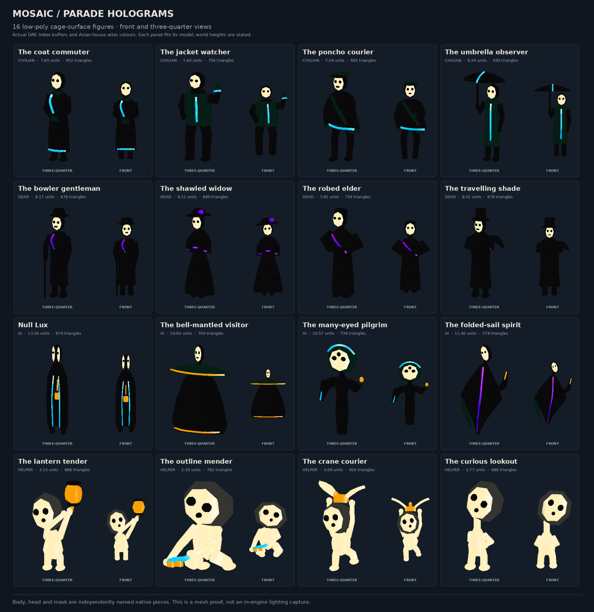
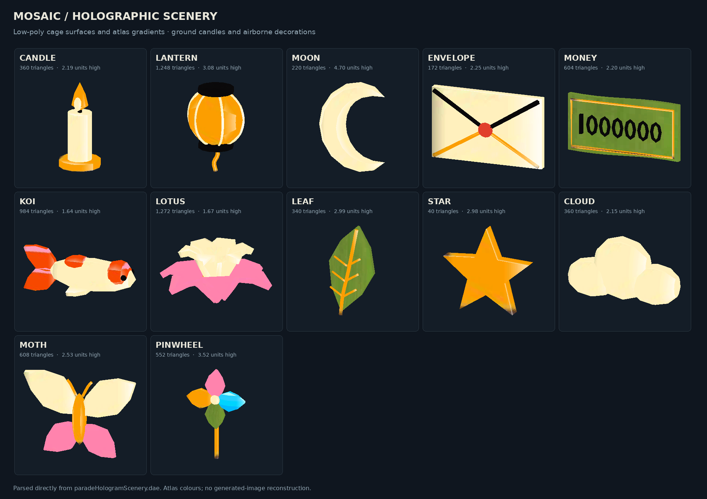

# Low-poly parade cage surfaces

The active export evaluates the editable spline cages directly through
`cage_surface.py`. Voxelization is retained only as a legacy authoring tool.
All 16 figures and 12 scenery props use low-poly surfaces, with separate
body/head/mask pieces and the existing behavior hooks. Total: 19,740 triangles.

`palette.json` selects existing Asian-house atlas gradient strips for ivory,
cyan, violet, gold and orange emission. UVs span each cage surface rather than
sampling a constant swatch. The original atlas files are unchanged. The shader
reads packed tex2 red for emission intensity and alpha for opacity. Texture
previews sample the real diffuse and emission maps per pixel.

# Parade hologram models

This package supplies the parade's masked audience and ceremonial scenery as
editable spline cages and low-poly native COLLADA meshes. It contains four
civilians, four dead people, four AI spirits, four helper programs, and twelve
decorations. The game meshes have **19,740 triangles across 60 independently
addressable geometry pieces**. The masks, heads and bodies are separate pieces.

The current artist-authored `truckPayloadParade.dae` is the preservation base.
Its existing 41 geometries, 41 authored nodes, materials, transforms and float
variants remain intact. `build.py` replaces only this package's generated
namespace and appends the scenery to the existing payload. It does not run the
historical six-float exporter.

## Files

| File | Purpose |
| --- | --- |
| [`../../objects3d/truckPayloadParade.dae`](../../objects3d/truckPayloadParade.dae) | Existing game payload with the new hidden scenery pieces embedded |
| [`../../objects3d/paradeHologramScenery.dae`](../../objects3d/paradeHologramScenery.dae) | Standalone model containing all sixteen visitors and twelve props; useful for import and inspection |
| [`Build_Parade_Hologram_Cages.ms`](Build_Parade_Hologram_Cages.ms) | Self-contained 3ds Max 2018 builder for the original editable cages |
| [`source/cages.json`](source/cages.json) | Complete control nets, spline paths, semantic groups and figure descriptions |
| [`figures.py`](figures.py), [`props.py`](props.py) | Authoring recipes used by deterministic regeneration |
| [`manifest.json`](manifest.json) | Per-model dimensions, triangle counts, material use and preservation fingerprints |
| [`../../luarules/configs/parade_hologram_models.lua`](../../luarules/configs/parade_hologram_models.lua) | Generated native piece names, dimensions and head pivots |
| [`../../luarules/configs/parade_hologram_scene.lua`](../../luarules/configs/parade_hologram_scene.lua) | Placement, visibility budgets and spectator families |
| [`../../luarules/gadgets/include/parade_hologram_scene.lua`](../../luarules/gadgets/include/parade_hologram_scene.lua) | Small, deterministic motion and persistent world-position behavior |

## Visitors

| Family | Variant 1 | Variant 2 | Variant 3 | Variant 4 |
| --- | --- | --- | --- | --- |
| Civilian | Coat commuter, clasped hands | Short jacket, raised greeting hand | Poncho courier, cap and bag | Fitted coat and umbrella |
| Dead | Bowler gentleman and cane | Shawled widow with wide hat | Robed elder | Travelling shade with tall hat and cape |
| AI | **Null Lux**, split mask and a lantern sheltered inside an open mantle | Broad bell-mantled visitor | Pilgrim with an oversized, three-eyed mask | Folded-sail spirit |
| Helper | Lantern tender | Crouching mender | Paper-crane courier | Curious lookout with a tilted head |

Civilian and dead models are approximately 7.6–8.8 world units high. The AI
spirits are 10.8–13.5 units high; helpers are 2.3–3.3 units high. The renderer
raises the dead's feet 8.8 units above the local terrain, placing their old
shoes and dress hems just above nearby living spectators. The dead use darker
materials and lower opacity; their identity comes from period clothing and
hovering, without missing-data or glitch animations.

Names follow `paradecivilian1` through `paradecivilian4`, `paradedead1` through
`paradedead4`, `paradeai1` through `paradeai4`, and `paradehelper1` through
`paradehelper4`. Each root has `body`, `head`, and `mask` children appended to
its name. For example, Null Lux uses `paradeai1body`, `paradeai1head`, and
`paradeai1mask`.

## Decorations and behavior

The native props are ground candles, floating paper lanterns, a crescent moon,
an envelope, a hyperinflation banknote, koi, lotus blossoms, leaves and stars.
Clouds, pinwheels and moths retain the previous decoration catalog's motifs.
Their native names are `paradecandle`, `paradelantern`, `parademoon`,
`paradeenvelope`, `parademoney`, `paradekoi`, `paradelotus`, `paradeleaf`,
`paradestar`, `paradecloud`, `paradepinwheel`, and `parademoth`.

The audience is placed at persistent world positions while a float passes.
The next station appears after 108 world units of travel, with a 1.6-second
crossfade. Only the current and previous station are retained. Candles rest
on sampled terrain and have no vertical bob. They do not slide along the road
with the carrier.

| Element | Motion |
| --- | --- |
| Civilians | Stationary bodies and a very slow head inclination of at most 1.5 degrees |
| Dead | Slow 0.10-unit hover and a small head inclination |
| AI spirits | Slow 0.14-unit hover and a small head inclination |
| Lanterns | Six per station: two stationary, two rising and two descending; three fixed identities and three that alternate between two modes |
| Koi | Gentle 0.18-unit hover at a fixed horizontal position; no rising/falling lifecycle |
| Banknotes | Continuous downward travel for 16 seconds, blink out at the ground, then restart above after 0.2 seconds hidden |
| Other airborne props | Gentle 0.18-unit float and 2-degree inclination |
| Lantern daemons | Three helpers approach a placement point, gesture, release a pair of lanterns, and return; over half of each cycle is spent resting |
| Lookout helper | Retains its original ten-second inspection cycle, short trips and bounded hops |

### Lantern distribution and placement

The six lantern identities share a station-local clock:

| Identity | First mode | Second mode |
| --- | --- | --- |
| Fixed 1 | Stationary | Stationary |
| Fixed 2 | Rising | Rising |
| Fixed 3 | Descending | Descending |
| Switching 1 | Stationary | Rising |
| Switching 2 | Rising | Descending |
| Switching 3 | Descending | Stationary |

The switching identities change together every **1.6 seconds**, preserving two
identities in each mode. Their heights and vertical velocities remain continuous
at switches. Stationary lanterns have no vertical bob or tilt. Ground-born
lanterns appear at the daemons' placement points **1.2 seconds** after a station
forms, during the placement gesture; they do not appear with the initial scenery.
Terrain is sampled at the actual placement or moving-helper coordinates.

Each release cycle lasts **6.4 seconds**: the six lanterns remain visible for
**6.2 seconds**, then blink out together for **0.2 seconds** before the next daemon
release. Lifecycle visibility is a boolean: there is no lantern or banknote
fade-in/fade-out envelope. Both render paths omit hidden poses from their draw
queues, so recycling requires no shader opacity control. Fixed rising and falling
lanterns never visibly reverse. Retired stations cannot release a new cohort.
The existing two-station history bounds each payload to at most twelve lanterns
during a station transition. Timings are deliberately short enough to see both
placement and switching while a moving parade passes.

The distance/capacity billboard renderer retains its existing artwork and uses
the same lantern cohort, world anchors and release timing for lantern-themed
floats. Zooming out therefore does not restore the former arbitrary bobbing.

The scenery integration in `736f09d` introduced a separate shader before these
behavior changes. That shader still supplies the older station and distance crossfades;
the shared `gfx_neonHolograms.lua` renderer has no per-object lifecycle-opacity
input. Binary lifecycle visibility does not migrate the scenery into that shared
renderer or its radiance capture path. That integration remains separate work.

### Petals and falling paper from buildings

The existing building showers retain their textures and particle counts. Flower
petals launch downward and use sampled map wind as horizontal acceleration.
Each new burst samples the current wind; already emitted particles retain that
sample. Inflation banknotes launch straight downward with downward gravity.
Confetti and origami retain their original outward toss and variation.

These are the existing `CSimpleParticleSystem` effects: petals and notes pass
through ground level and become terrain-occluded, then expire. They do not leave
persistent objects on the ground.

This is unsynced visual behavior. It issues no game orders, adds no simulated
units and does not use MoveCtrl. Visibility continues to follow the actual
carrier: attachment, life, line of sight, cloaking, hidden rendering and parade
retirement are checked. Native scenery is bounded to the nearest four eligible
payloads and fades from 750 to 1,150 world units. At close range it owns the
view, including its initial materialization, so the old floating candle sprites
and outlined figures are not drawn over the new scene. Between 750 and 1,150
units the two scenes crossfade. The original sprite catalogs and renderer
remain the fallback beyond that range, outside the four-scene budget, or if
any required native pieces or rendering capabilities are unavailable.

The current 24-float catalog and all 16 articulated subpiece motions are retained.
The recovered lookup adapter is used only by the scenery renderer.

`luarules/configs/parade_hologram_scene.lua` enables the new scene by default.
Set `enabled = false` to restore the original native roadside projection system,
including its 27 modular ghost combinations. The two renderers are mutually
exclusive. The new renderer is `gfx_parade_scenery.lua`; its own distance and
missing-mesh fallback remains available.

## Editable cages in 3ds Max

Run `Build_Parade_Hologram_Cages.ms` from this directory. It creates real
SplineShapes and renderable spline contours. Surface, Shell where needed,
Normal, UVW Map and UVW Xform remain live modifiers; source splines are not
collapsed. Body, head and mask have separate dummy controls, with the mask
following its head pivot. Existing scene nodes are checked before construction.

The default atlas directory is `../../unittextures`. Set `MPHC_AtlasDir` before
running the script to use another location containing the matching
`house_asian_diffuse.dds` and `house_asian_selfilu_reflection.png`. The builder
checks the atlas pair and the small palette islands. Optional review layout
moves only each model's root; the authored feet and local coordinates remain
unchanged.

The editable scene uses X right, Y depth and Z up, facing -Y. Scripted exports
rotate this to game X right, Y up and +Z forward. The Python recipes and their
saved control nets are the reproducible export source; the `.ms` builder is an
editable native authoring version of those same cages.

The game exporter evaluates the cage surfaces directly and triangulates them.
Flat normals retain the authored facets; each surface maps across its atlas
gradient. Semantic groups preserve separate body, head and mask pieces.

## Regeneration and checks

From the repository root, with Python 3 and NumPy, lxml and Pillow:

```sh
python tools/parade_holograms/build.py
python tools/parade_holograms/render_preview.py
```

The preview command writes local PNG proofs and self-contained SVG copies in
`docs/images/parade-holograms`. Each SVG embeds the exact PNG bytes without
re-encoding; the documentation uses the SVG copies.

The build is idempotent, including the updated payload, standalone model,
metadata, control-net JSON and MaxScript. The standalone DAE uses metre=1 and
identity nodes. Native drawing calls `gl.UnitPiece` on raw final-world-unit
vertex buffers. It intentionally does not apply the original FBX payload's
`.0254` root scale, container rotation or piece matrix to these scenery meshes.
The original payload's own metadata and transforms are preserved.

The hologram shader uses diffuse RGB, packed red emission and packed alpha opacity.
Diffuse alpha is the team-color mask, and is not used as opacity. Standard
alpha blending keeps dark silhouettes and mask eye apertures visible.

For independent XML, topology, UV, scale, preservation and native Assimp import
checks, install `assimp-py` and run:

```sh
python tests/parade_hologram_models_test.py --base-ref 6d7df3d2
lua tests/parade_hologram_scene_test.lua
lua tests/parade_scenery_renderer_test.lua
lua tests/parade_holograms_test.lua
lua tests/truck_parade_payloads_test.lua
lua tests/city_parade_test.lua
```

`luatex --luaonly` can run the Lua suites where a standalone `lua` executable
is unavailable. The model validator also accepts `--base-dae` for comparison
against a separately retained artist export. It compares original scene
definitions independently of the generator and checks the exported DAE buffers.

## Geometry previews





These are rasterizations of the exported mesh and atlas coordinates, not game
captures. Live Recoil lighting/performance and execution of the editable
builder in 3ds Max remain the two manual visual checks.

For an in-game procession without waiting for the seventh evening:

```text
/cheat
/luarules parade start
/luarules parade status
/luarules parade stop
```
